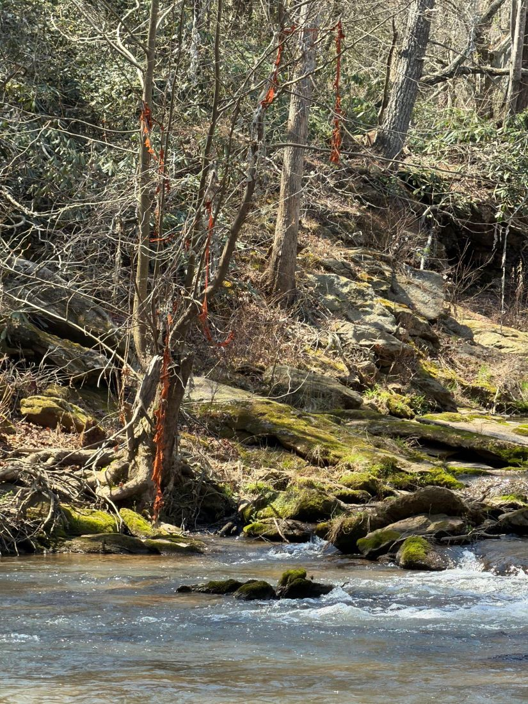
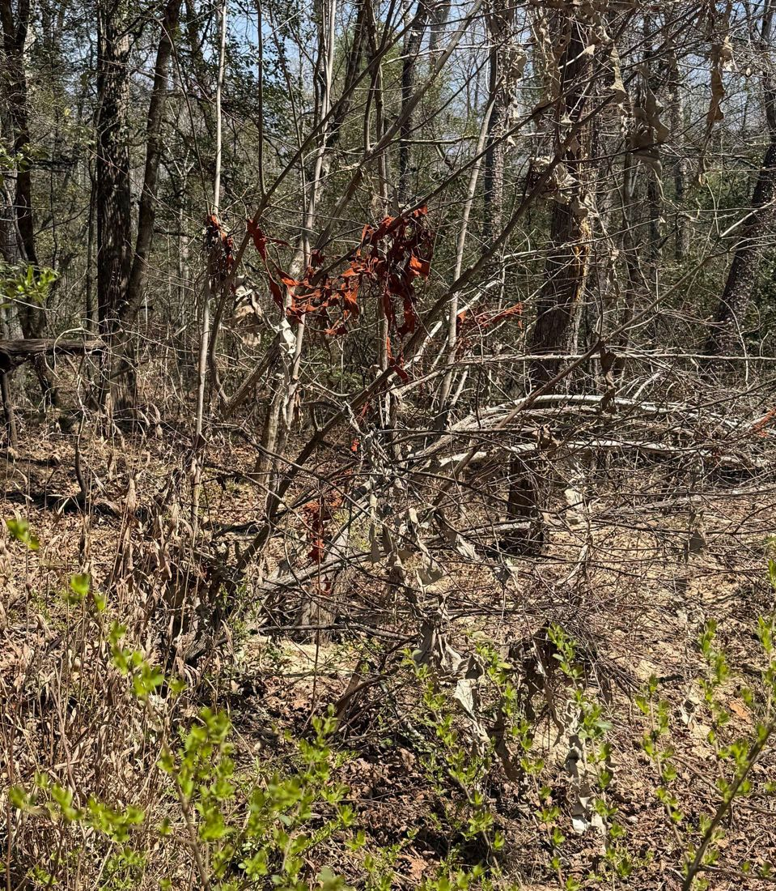
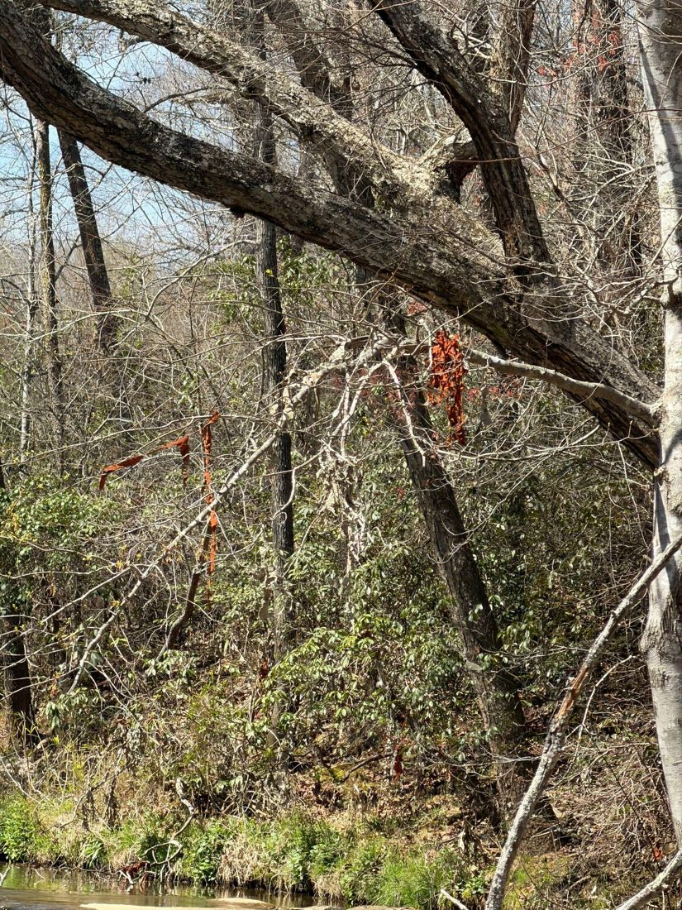
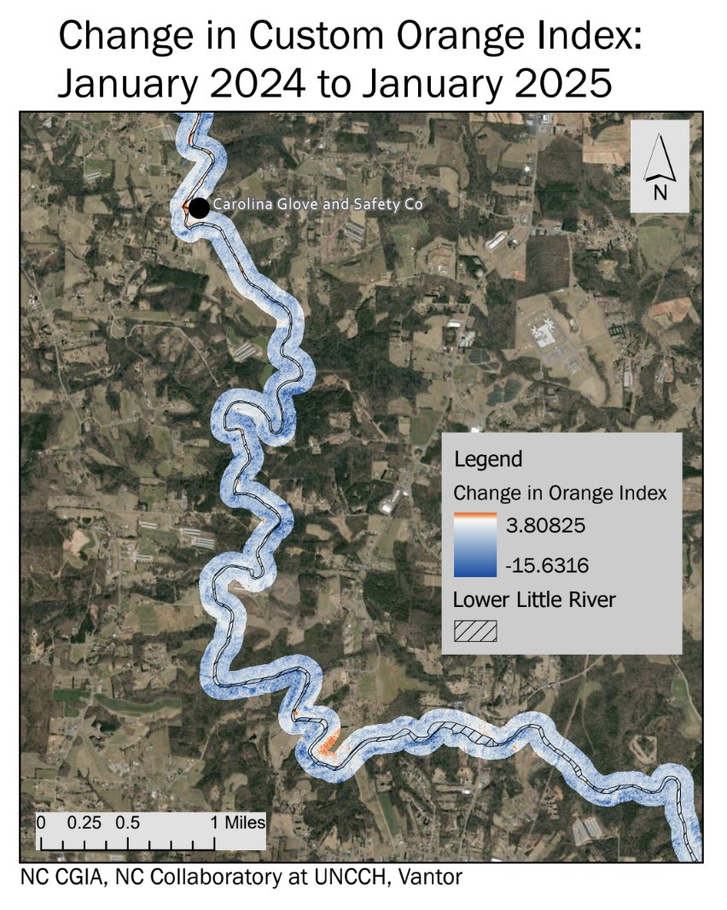
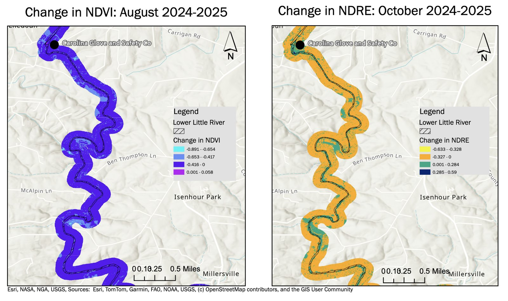
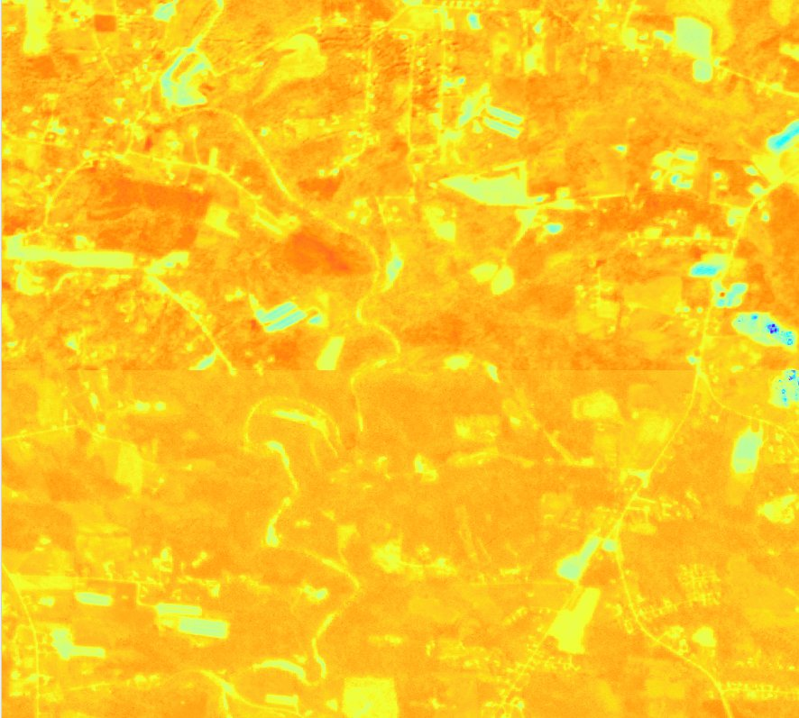

## Introduction and Research Goals

This project's original goal was to determine whether a remote sensing approach could be used to detect the extent of debris along the Lower Little River, which is located in Alexander County in western North Carolina. During Hurricane Helene, which hit the region in late September, 2024, this relatively small river experienced substantial flooding, and a small safety equipment factory, Carolina Glove and Safety Co, was inundated in the floodwaters, resulting in scraps of orange and teal surplus leather from the factory being dispersed in the riparian vegetation downstream. These long strips of leather debris remained lodged in the branches of the trees along the river and persist in 2026. My original goal was to assess the extent of the downstream impact of the debris and also to see how that impact and debris presence has changed over time. This context comes from my firsthand observations of the flood zone and the accounts of family members living along the downstream portion of the river during the impacted time period. While ground truthing during the semester was not possible, I observed a high density of leather debris during all of the time periods used in this analysis through frequent visits to the family's riverside property.

Because the shallow and rocky river is not navigable by kayak or other vessels during much of the year, and because much of the affected area is privately owned, a remote sensing approach presented a unique opportunity to map the entire downstream portion of the river and understand how this industrial pollutant may have impacted riparian plant communities, a less-investigated impact of a large natural disaster like Hurricane Helene.

::: {layout-ncol=3}
{group="helene"}

{group="helene"}

{group="helene"}
:::

*Figure 1. Images of Persistent Glove Factory Debris in March 2026*

## Key Geospatial Data

The data for this project was obtained through Planet Labs's Education and Research Program. Satellite Imagery for all dates was captured by the PSB.SD (SuperDove) instrument on the Dove flock satellites, and "captures red, green, blue, near infrared, as well as a new red edge, green I, coastal blue, and yellow channel" at a resolution of 3x3 meters within this area of interest^1^.

Flow lines and surface water for the Lower Little River were extracted from the Esri layer for the National Hydrography Dataset Plus High Resolution\\Waterbodies and Areas by clipping the national file features to the area of interest and manually removing the features for the surrounding ponds and other water bodies.

Using the data retrieved from PlanetLabs's PSB.SD (SuperDOVE) Satellite Imagery, I narrowed down the following pairs of raster files for my subsequent processing. All images were requested as Non-Composite Surface Reflectance - 8 band (corrected for Surface Reflectance and recommended for most analytic applications). After originally downloading some images as composites and facing issues in differing image resolution and metadata loss in overlapping areas, I decided to download all images as non-composite, and selected dates that both avoided cloud cover interference and had one pass over the majority of the area of interest to avoid the need to rectify issues with overlapping imagery. All satellite images were captured in the afternoon between 12-3 pm Eastern Time

- January 18th 2024 and January 8th 2025 (Orange Index)
- August 10 2024 and August 29th 2025 (NDVI)
- October 10th 2024 and October 19th 2025 (NDRE)

These dates were chosen to approximate the same time of year as closely as possible while avoiding cloud cover issues. The January data was used to obtain leaf-off imagery of the riverbank, as the overhanging tree canopy during the growing season would make visual analysis of the riverbank riparian vegetation impossible.

## Spectral Indices Data Processing using ArcGIS

Using the raster file above, the following spectral indices were calculated:

1) Custom Orange Index – This aimed to detect the presence of glove debris along the riparian zone of the river in areas where I have confirmed that glove debris was present during January 2025. Using Raster Calculator, I added Red (Band 6) + Yellow (Band 5), and divided the sum by the Blue band (Band 2).

2) NDVI or Normalized Difference Vegetation Index - This index aims to quantify vegetation greenness, density, and overall vegetation health. I used the ArcGIS NDVI tool and ensured the set bands were correct for the SuperDove satellite for NDVI Calculation, which is NIR (Band 8) - R (Band 6) / NIR (Band 8) + R (Band 6)

3) NDRE or Normalized Difference Red Edge - This index aims to more specifically quantify the riparian vegetation health later in the growing season as it is more sensitive to detecting plant stress and chlorophyll content in plants. A decrease in NDRE might indicate that plants are suffering from nutrient deficiency or other stress. I calculated this using the NDVI Raster tool, but replaced the Red band (Band 6) with the Red Edge band (band 7) to align with the formula for NDRE (NIR - Red Edge / NIR + Red Edge)^2^

I did attempt to analyze change detection in only the yellow band change between the two years as well as only the orange band, but without substantial results, which led me to attempt to create a custom debris index.

## Change Detection using ArcGIS

After running the calculations to obtain the indexes, I used the Calculate Change tool to create a new raster mapping the change in each index between the 2024 datasets and the 2025 datasets, where a positive change means the value of the index was higher in 2025 than in 2024, and a negative change value means the value of that index decreased. I then used Extract by Mask to create a raster that only included the change values for a 500 foot buffer from the river to avoid data noise or interference from the surrounding buildings, streets, and agricultural areas. The results for this change detection analysis are shown in Figures 2 and 4.

{group="helene" fig-align="center" width="70%"}

## Spatial Analysis in ArcGIS and R

The resulting raster files above (Change in Orange Index, Change in NDVI, and Change in NDRE) were processed using the Buffer tool to create two new raster files per metric. The first raster was a 50 foot buffer from the Lower Little River, and the second was a 500 foot buffer from the Lower Little River. The latter 500 foot buffers were then re-processed using the Erase tool to remove the pixels included in the original 50 foot buffer so that the smaller buffer contents would not influence the statistics for the 500 foot buffer. The goal of this step was to assess whether the mean change differed between a 50 foot riparian buffer zone and a 500 foot control zone and draw conclusions on whether pollution from the river might have influenced changes.

In order to meaningfully compare the means of the above statistics, the Zonal Statistics tool was used to calculate the mean values and the mean, median, mode, and minimum/maximum values for the following raster files:

- Orange_Index_50ftbuffer
- Orange_Index_500ftbuffer
- Change_NDVIAug_50ftbuffer
- Change_NDVI_Aug_500ftbuffer
- Change_NDRE_Oct_50ftbuffer
- Change_NDRE_Oct_500ftbuffer

Because of the large N of remote sensing data, which consists of very high numbers of pixels, a straightforward comparison of means test showed high levels of significance but was not meaningful due to p-value inflation in very high N data. Instead, I used R to input my summary statistics and calculate the Cohen's D effect size for each pair as well as the 95% confidence intervals to detect whether there was a significant effect of buffer size on the mean change value for each pair of indexes. This allowed me to meaningfully compare whether the 50 foot buffer mean value differed from the 500 foot mean value, although it does not allow me to determine why that is. The results of this analysis are below:

| Metric | 50ft Buffer | 500ft Buffer | Difference | % Change | Cohen's d | Effect Size | 95% CI |
|:--|--:|--:|--:|--:|--:|:-:|:-:|
| Orange Index | -2.4934 | -1.1910 | -1.3024 | -52.2 | -1.474 | Large | [-1.3051, -1.2996] |
| NDVI Change (Aug) | -0.3287 | -0.3472 | 0.0185 | 5.6 | 0.237 | Small | [0.0183, 0.0188] |
| NDRE Change (Oct) | 0.5523 | -0.0104 | 0.5627 | 101.9 | 2.253 | Large | [0.5619, 0.5635] |

: Figure 3. Statistical Comparison of Remote Sensing Indices

{group="helene"}

## Results and Interpretation

These results indicate a large difference in the change in Orange index for the 50 foot riparian area versus the 500 foot control area. However, the results are the opposite of what I expected. Between January 2024 and January 2025, the mean change for the 50 foot buffer was -2.49 compared to a mean change of -1.19 in the 500 foot control area, meaning that both areas became less orange in 2025, and that change was much stronger in the 50 foot buffer area. If the Orange Index was a useful metric for detecting glove leather debris, I expected to see a positive change in means, and a stronger positive change in the 50 foot buffer area. I've concluded from these results that the index I created was not an effective way to detect the presence of glove debris, likely due to interference of changes in water quality or sediment levels in the 50 foot buffer area, as I elected not to mask out water using an NIR mask for risk of removing key edge pixels along the banks. The map visualization shows how some areas of high orange index change are clustered along the bank sporadically, and many of these seem to be associated with barren or agricultural areas directly adjacent to the river, potentially resulting in a high level of runoff or sedimentation impacting the index.

The results for NDVI show only a small effect size, with the mean change from August 2024 to August 2025 being similar for both 50 foot and 500 foot buffer. The ~-0.3 change in NDVI in both buffer areas indicates that the entire area, not just the riparian buffer, suffered a change in vegetation with plant die-off, loss of greenness and overall vegetation loss. The reasons for this cannot be determined through remote sensing analysis alone, but possible reasons include pollution in the riparian area from the 2024 hurricane season, landcover change due to flooding and erosion in this area during the storm resulting in changes in stream path, or the drought conditions that proliferated in central and western North Carolina during the summer of 2025.

The most interesting results came from the NDRE comparison. Between October 2024 and October 2025, the mean NDRE for the 500 foot control area decreased negligibly (-0.01), while the mean NDRE for the 50 foot buffer increased by 0.5, a large and noteworthy difference. Again, there is a possibility that this may be linked to interference from water, and there is some possibility that much of the 50 foot buffer area was still flooded from the hurricane in early October of 2024, causing artificially negative NDRE values in 2024 and leading to the resulting positive change in 2025. However, operating under the assumption that water interference is not the cause of the difference in NDRE, there are a few potential interpretations. First, even though the August to August NDVI was negative for this same area, the positive change in October to October NDRE could indicate that the while overall vegetation in the riparian area may have decreased, the post-disturbance vegetation the following year is healthier with a higher chlorophyll content due to greater sun exposure from flood-cleared vegetation. Because October of 2024 was after the hurricane, it's possible that there was an immediate decline in NDRE in the weeks following, but it seems unlikely that such an immediate vegetation health decline would take place. My best estimate is that a combination of floodwater interference in the 2024 dataset and vigorous growth in the following season of the disturbed riparian area combined to create such a positive change in NDRE.

{group="helene" fig-align="center" width="60%"}

For reference, the screenshot in Figure 5 shows the difference between overall NDRE for October 2024 (bottom) and October 2025 (top) using the swipe tool, showing that in 2025 there appeared to be more spatial variation in NDRE throughout the area of interest.

## Conclusions and Reflections on Future Research Steps

One of the main technical hurdles I encountered was the resolution of the data, as 3x3 meters was too large to get any pure pixels for the debris, and most pixels impacted by debris are also likely mixed with the stream edges and water. This leads to difficulty in analyzing the extent of the debris, for which I was ultimately unsuccessful. If high-resolution leaf-off LIDAR data was available for this area, it would be possible to do structural analysis for changes in the shape of the branches due to the debris to actually analyze the debris extent.

Another issue was interference with water and potentially waterlogged soils, particularly in the October 2024 dataset, but present throughout. I did initially attempt to mask out the water using a Normalized Difference Water Index and then by setting a threshold for a minimum NIR reflectance, but neither fully masked out the water due to the shallowness of the river compared to the depth of the lake that was present in the full area of interest. In order to avoid masking out edge pixels that have some water and some branches and debris, I opted not to mask out water at all. However, because water was present in the 50 foot buffer area, it certainly could have impacted the comparative calculations with the surrounding buffer area.

This project also emphasized the importance of ground truthing and verification. The absence of ground truthing data for the extent of floodwaters and the true spectral signature of the debris made detecting the debris extent very difficult to impossible in this case, and also could influence the results for the NDVI and NDRE analysis. Neither my custom orange index or a purely yellow-band comparison yielded substantial results or noticeable patterns. A future extension of this project could work on a robust way to mask out all-water pixels, account for changes in water sediment for edge pixels, and try to obtain more high-resolution data to take a classification approach to debris presence using a verified spectral signature for the debris. In the coming months, I plan to do a potential ground-truthing excursion by foot and kayak with the collaboration of neighbors to map GPS points of existing debris to create a more robust map in the future. An attempt at principal components analysis could also yield interesting results, but the large file size even for this small AOI kept crashing R on my computer, so this will be a project for future inquiry.

## Works Cited

1. Planetscope. Planet Documentation. (2026, March 17). <https://docs.planet.com/data/imagery/planetscope/>
2. NDRE index: Vegetation Analysis in mid and late season. EOS Data Analytics. (2025, September 16). <https://eos.com/make-an-analysis/ndre/>
